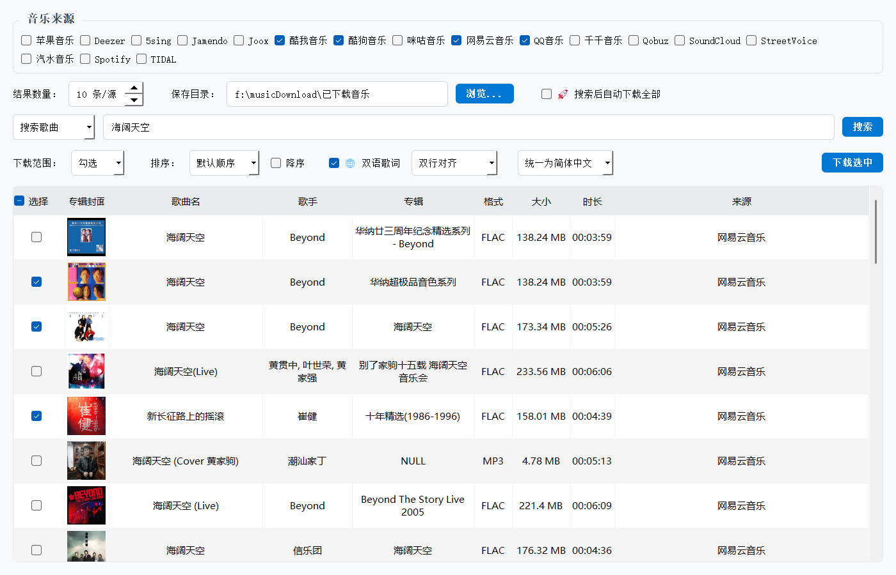
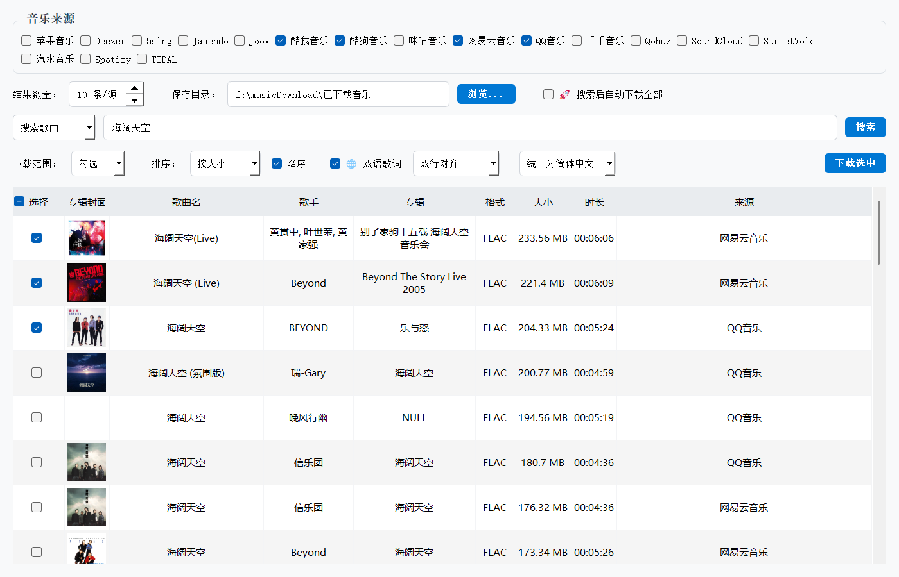
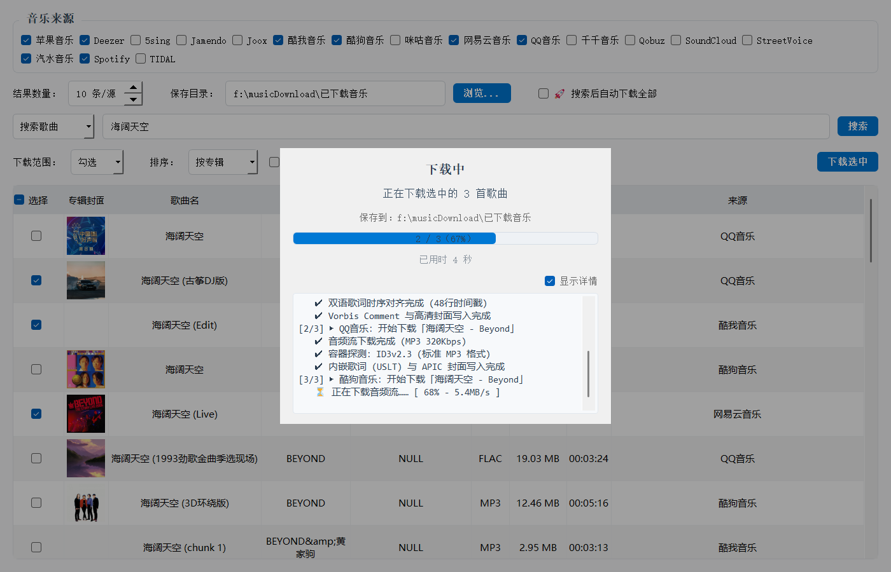

<h1 align="center">MusicDownload</h1>

<p align="center">
  🇨🇳 <a href="./README.md">简体中文</a> | 🇺🇸 <a href="./README_EN.md">English</a>
</p>

<p align="center">
  
  
  
  
  
</p>

**MusicDownload** 是一款基于 Python 和 PyQt5 构建的高性能全功能音乐下载与元数据增强工具。本项目以开源项目 [musicdl](https://github.com/CharlesPikachu/musicdl) 为基础引擎，进行了深度的架构重构、功能扩展与交互现代化改造，全面解决了原版在音源匹配、元数据写入、歌词对齐及打包体积上的痛点。

---

### ✨ 核心特性与对比原版的深度改进

#### 1. 🎵 聚合 17 大主流音乐平台
* **国内音源**：网易云音乐、QQ音乐、酷狗音乐、酷我音乐、咪咕音乐、汽水音乐、千千音乐、5sing；
* **国际音源**：Apple Music、Spotify、Deezer、TIDAL、Qobuz、SoundCloud、Jamendo、Joox、StreetVoice；
* **智能音源穿透**：针对 Spotify 等仅有元数据的国际音源，内置时长容差与歌名模糊匹配算法，自动穿透检索第三方高质量音轨，确保下载准确无误。

#### 2. 🏷️ 原子级音频元数据深度修复与嵌入 (`audio_metadata.py`)
* **真实容器校验**：通过底层二进制 Header 探测真实音频格式（彻底解决源站将 FLAC 格式错误命名为 `.mp3` 导致解析崩溃的问题，自动纠正文件扩展名）；
* **非破坏原子写入**：改写标签在临时副本中完成，通过校验后原子替换；
* **进程占用自动重试**：针对 Windows 杀毒软件或资源管理器导致的 `PermissionError`，内置指数退避重试机制，杜绝标签静默丢失；
* **全字段完整写入**：全面支持 MP3、FLAC、M4A、OGG、WAV 等格式的标题、艺术家、专辑、内嵌歌词（USLT / Vorbis / MP4）及高清专辑封面（APIC / Picture）。

#### 3. 🌐 智能双语歌词与时序对齐 (`bilingual_lyric.py`)
* **毫秒级容差时序对齐**：采用双指针时间窗口算法，精准合并外语歌词原文与中文翻译；
* **三种主流排版自由选择**：
  * **双行同时间戳 (`dual_line`)**：原文与译文各占一行但共享同一时间戳，在车机、手机播放器（如海贝、Poweramp、Foobar2000）中完美滚动显示；
  * **单行行内拼接 (`inline`)**：原文与译文单行合并；
  * **纯中文翻译 (`translation_only`)**：仅保留中文译文；
* **跨源穿透补全**：自动判定歌曲语种，支持从网易云/QQ 音乐跨源补全高质量双语 LRC。

#### 4. 🔤 歌词简繁中文智能转换 (`zh_converter.py`)
* **灵活转换模式**：支持「保持原样」、「转换为简体中文（推荐车机及内地用户）」、「转换为繁体中文（适合海外及港台偏好）」；
* **双层渐进保障**：优先使用 `zhconv` 进行词组级精确转换；在纯离线或无第三方库环境下，自动降级至内置高频繁简汉字映射表；
* **严格格式保护**：严格保护 LRC 时间戳 `[mm:ss.xx]`、歌曲元数据 `[ti:]` 以及日文假名、韩文谚文，绝不误伤非汉字文本。

#### 5. 💾 智能使用偏好记忆与绿色便携配置 (`config_manager.py`)
* **纯绿色便携存储**：基于本地 `config.ini` 与 `QSettings(IniFormat)`，软件拷入移动设备即插即用，同时内置越界屏幕防护与只读目录 `%APPDATA%` 自动回退保护；
* **全方位记忆使用习惯**：
  * **下载与路径**：自动记住自定义保存目录（支持界面一键快速"打开目录"）、单源结果上限、下载范围（全选/勾选/未选）、搜索后自动下载；
  * **音源平台偏好**：精准保留用户自定义勾选的音乐平台组合，提供「全选」、「清空」、「国内主流」、「重置默认」一键预设；
  * **界面与交互状态**：关闭时自动静默保存窗口尺寸与停靠位置、结果表格各列拖拽后的宽度与排列状态；
  * **搜索历史自动补全**：内置最近搜索历史记忆与下拉模糊匹配，支持一键清空；
  * **配置定位与出厂重置**：顶部菜单提供「偏好设置」，支持一键在资源管理器中定位 `config.ini`，并支持一键恢复出厂设置。

#### 6. ⚡ 现代 PyQt5 界面与全场景动态过程遥测 (Project Telemetry)
* **终端 Console + 桌面 GUI 双模动态过程显示**：
  * **终端沉浸式交互**：原生集成基于 `rich` 的多任务细线动态进度条、多源分页搜索树、瞬时网速（MB/s）与剩余时间精准倒计时；
  * **PyQt5 现代多任务监视仪表盘**：内置 `ModernProgressDialog`，支持单曲微缩卡片组、彩虹细线进度条、各任务状态胶囊（排队/下载中/歌词时序对齐/写入标签/完成/失败）；
  * **10 FPS 安全节流与 EWMA 平滑算法**：千兆突发 chunk 下 UI 依然丝滑不卡顿，CPU 占用率低于 1%，平滑解决速度数值剧烈跳变痛点。
* **封面异步线程池流式加载**：引入代际缓存（Generational Cache）与多线程图像处理，海量搜索结果快速滚动时界面丝滑不卡顿；
* **现代化交互组件**：
  * 支持自适应换行流式布局（FlowLayout），音源筛选自由缩放；
  * 表头集成一键全选/反选多态复选框；
  * 搜索框支持 **Enter 回车直接搜索**，无需手动点击按钮；
  * 支持右键上下文菜单、双击详情查看；
  * 抽屉式可折叠的实时运行日志面板。

#### 7. 📦 纯净虚拟环境与极致瘦身打包
* **一键打包脚本**：内置 `make_release.bat`，自动检测 `.venv` 隔离环境；
* **深度结构性瘦身**：在 `musicdownload.spec` 中剔除 `numpy`、`matplotlib`、`pandas`、`av`、`lxml` 等庞大无用库，并移除 PyQt5 冗余的 20MB `opengl32sw.dll` 驱动；
* **UPX 深度压缩与崩溃白名单保护**：将输出单文件体积压缩至约 **44 MB**，同时对 Qt 平台插件与 VC 运行时设置白名单，保证程序运行稳定不崩溃。

---

### 🖥️ 软件截图

<table align="center" border="0" cellpadding="10">
  <tr>
    <td align="center">
      <br>
      <b>主界面与聚合搜索</b>
    </td>
    <td align="center">
      <br>
      <b>曲目按字段排列</b>
    </td>
    <td align="center">
      <br>
      <b>下载进度与实时日志</b>
    </td>
  </tr>
</table>

---

### 📂 项目架构

```text
MusicDown/
├── musicdownload.py        # 主程序入口：包含现代化 PyQt5 GUI、多线程并发控制器与业务逻辑
├── telemetry_hub.py        # 核心模块：统一过程遥测中枢、EWMA速率平滑算法与 Rich 终端渲染器
├── telemetry_widgets.py    # 界面组件：PyQt5 现代化多任务下载仪表盘、流式卡片与 10 FPS 节流桥
├── config_manager.py       # 偏好配置模块：基于本地 INI 的集中式使用习惯与窗口状态持久化
├── audio_metadata.py       # 模块一：音频底层容器探测、安全重试与元数据/封面写入引擎
├── bilingual_lyric.py      # 模块二：双语歌词时序对齐、格式重构与跨源补全模块
├── zh_converter.py         # 模块三：中文简繁体智能转换模块（双层渐进式保护）
├── musicdownload.spec      # PyInstaller 专业瘦身与依赖隔离打包配置文件
├── make_release.bat        # Windows 纯净虚拟环境 + UPX 一键自动化打包脚本
├── requirements.txt        # 核心依赖清单
├── config.ini              # 绿色便携用户偏好配置文件（自动生成）
├── tools/                  # 打包工具依赖（内置 Windows 平台 UPX 压缩程序）
│   └── upx/
│       └── upx.exe
└── images/                 # 软件界面预览截图
```

---

### 🚀 快速上手

#### 运行环境
* 建议使用 **Python 3.10 ~ 3.14**。

#### 源码运行步骤
```bash
# 1. 克隆代码仓库
git clone https://github.com/waves-dylan/MusicDown.git
cd MusicDown

# 2. 创建并激活虚拟环境（推荐）
python -m venv .venv
.venv\Scripts\activate

# 3. 安装项目依赖
pip install -r requirements.txt

# 4. 运行主程序
python musicdownload.py
```

---

### 🛠️ 编译打包单文件发布版

项目已为您配置好经过体积与性能调优的打包方案：

```bat
# 确保在项目根目录下，直接双击或在命令行运行：
.\make_release.bat
```
打包成功后，输出的单文件可执行程序将自动同步在项目根目录下的 `musicdownload.exe`。

---

### 📄 开源鸣谢
* 核心音乐检索解析引擎：[musicdl](https://github.com/CharlesPikachu/musicdl) by CharlesPikachu
* 音频元数据处理：[mutagen](https://github.com/quodlibet/mutagen)
* 简繁转换：[zhconv](https://github.com/zh-code/zhconv)
* GUI 框架：[PyQt5](https://www.riverbankcomputing.com/software/pyqt/)

---

### ⚖️ 免责声明
本项目仅供 Python 编程学习、网络技术研究与个人音乐收藏整理使用。音频与歌词版权归各大音乐平台及原权利人所有，请勿将本软件用于任何商业用途。
