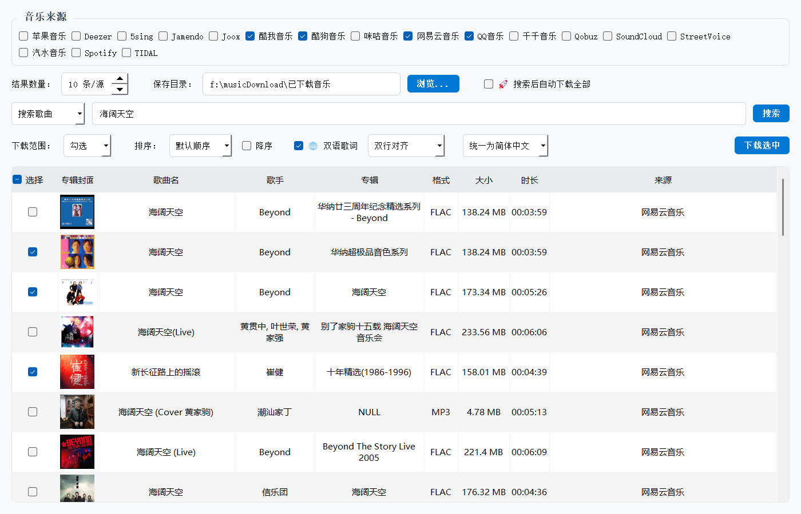
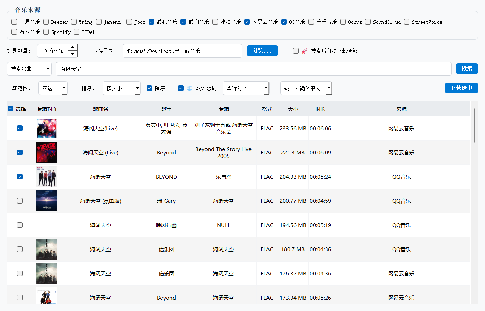
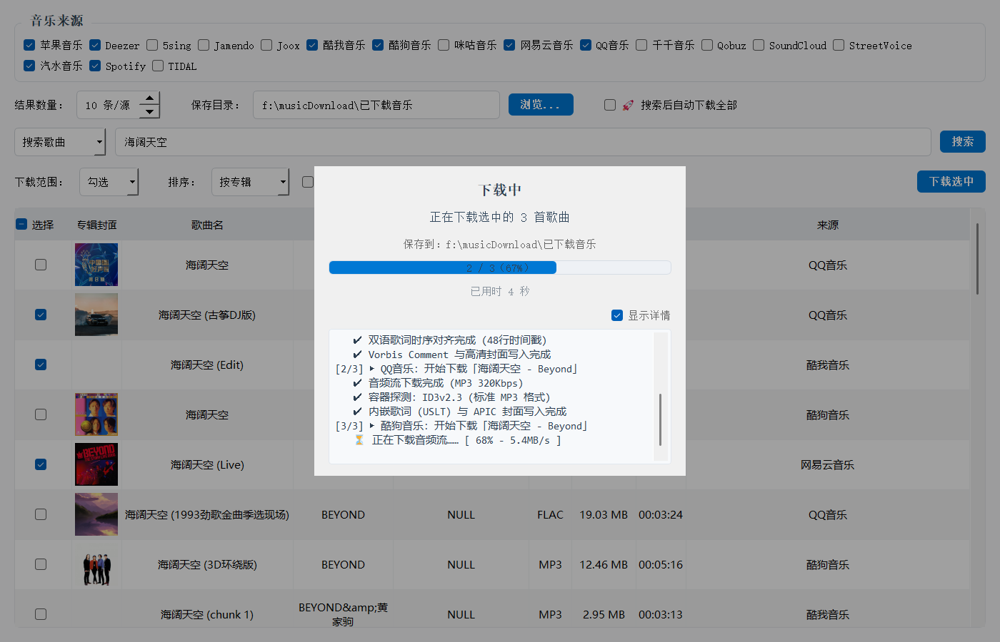

<h1 align="center">MusicDownload</h1>

<p align="center">
  🇨🇳 <a href="./README.md">简体中文</a> | 🇺🇸 <a href="./README_EN.md">English</a>
</p>

<p align="center">
  
  
  
  
</p>

**MusicDownload** is a high-performance, full-featured music downloading and metadata enhancement tool built with Python and PyQt5. Based on the open-source engine [musicdl](https://github.com/CharlesPikachu/musicdl), this project features deep architectural refactoring, feature expansions, and modern UI upgrades—resolving common issues with audio matching, metadata tagging, lyrics synchronization, and executable bloat found in earlier versions.

---

### ✨ Key Features & Major Enhancements

#### 1. 🎵 17 Aggregated Music Platforms
* **Domestic Sources**: NetEase Cloud Music, QQ Music, Kugou, Kuwo, Migu Music, Soda Music, Qianqian Music, 5sing;
* **International Sources**: Apple Music, Spotify, Deezer, TIDAL, Qobuz, SoundCloud, Jamendo, Joox, StreetVoice;
* **Smart Matching for International Sources**: For metadata-only sources like Spotify, built-in duration-tolerance and title fuzzy-matching algorithms seamlessly find high-quality third-party audio streams with high precision.

#### 2. 🏷️ Atomic Audio Metadata Tagging & Cover Embedding (`audio_metadata.py`)
* **True Audio Container Detection**: Detects file formats directly from binary headers (preventing parser crashes when CDNs serve FLAC files mislabeled with `.mp3` extensions and correcting file extensions automatically);
* **Non-destructive Atomic Writes**: Tagging is performed on a temporary copy and atomically replaced only after verification passes;
* **Process Lock Retry**: Built-in exponential backoff retry handles Windows file locks (`PermissionError`) caused by antivirus software or Windows Explorer, preventing silent metadata drops;
* **Comprehensive Tag Support**: Writes Title, Artist, Album, Track Number, Embedded Lyrics (USLT / Vorbis / MP4), and High-Resolution Album Art (APIC / Picture) across MP3, FLAC, M4A, OGG, and WAV.

#### 3. 🌐 Smart Bilingual Lyrics Synchronization (`bilingual_lyric.py`)
* **Millisecond-Accurate Alignment**: Dual-pointer time-window algorithm accurately aligns foreign lyrics with Chinese translations;
* **3 Formatting Modes**:
  * **Dual Line (`dual_line`)**: Both original and translated lines share the same timestamp for clean scrolling on car dashboards and players (Poweramp, Foobar2000, Hiby Music);
  * **Inline (`inline`)**: Merges original and translated lyrics onto the same line;
  * **Translation Only (`translation_only`)**: Keeps only the translated lyrics;
* **Cross-Source Lyrics Enrichment**: Automatically detects song languages and retrieves high-quality bilingual LRC lyrics from NetEase or QQ Music.

#### 4. 🔤 Simplified & Traditional Chinese Conversion (`zh_converter.py`)
* **Flexible Conversion**: Supports "Keep Original", "Convert to Simplified Chinese", and "Convert to Traditional Chinese";
* **Progressive Fallback**: Uses `zhconv` phrase-level conversion when available, seamlessly falling back to a comprehensive built-in character map in offline or portable environments;
* **Format Protection**: Strictly protects LRC timestamps `[mm:ss.xx]`, header tags `[ti:]`, and Japanese Kana / Korean Hangul characters from unintended translation.

#### 5. ⚡ Modern PyQt5 UI & Asynchronous Performance
* **Asynchronous Album Art Loading**: Leverages thread pools and generational caching to ensure butter-smooth table scrolling even with hundreds of search results;
* **Concurrent Multi-Threaded Downloads**: Completely decouples background download workers from the UI, offering real-time progress percentages, dynamic speeds, and duration timers;
* **Modern UI Controls**:
  * Responsive FlowLayout for music source selection chips;
  * Tri-state header checkbox for one-click selection and inversion;
  * Right-click context menus and double-click inspection;
  * Collapsible drawer-style live log terminal.

#### 6. 📦 Clean Packaging & Binary Optimization
* **One-Click Build Script**: Comes with [make_release.bat](file:///f:/musicDownload/make_release.bat), automatically leveraging the local `.venv` environment;
* **Structural Dependency Pruning**: Customized [musicdownload.spec](file:///f:/musicDownload/musicdownload.spec) excludes unnecessary heavyweight libraries (`numpy`, `matplotlib`, `pandas`, `av`, `lxml`) and eliminates PyQt5's redundant 20MB `opengl32sw.dll` software renderer;
* **UPX Compression with Crash-Protection Whitelist**: Compresses the standalone executable down to ~**44 MB**, while protecting critical Qt and VC runtime libraries from corruption.

---

### 🖥️ Screenshots

<table align="center" border="0" cellpadding="10">
  <tr>
    <td align="center">
      <br>
      <b>Search & Main Interface</b>
    </td>
    <td align="center">
      <br>
      <b>Sorting Tracks by Field</b>
    </td>
    <td align="center">
      <br>
      <b>Progress & Live Log Drawer</b>
    </td>
  </tr>
</table>

---

### 📂 Project Structure

```text
musicDownload/
├── musicdownload.py        # Main entry point: Modern PyQt5 UI, concurrency control & business logic
├── audio_metadata.py       # Module 1: Container verification, atomic metadata & album art tagger
├── bilingual_lyric.py      # Module 2: Bilingual LRC alignment, layout restructuring & enrichment
├── zh_converter.py         # Module 3: Simplified/Traditional Chinese text conversion engine
├── musicdownload.spec      # PyInstaller spec for size optimization & isolated bundling
├── make_release.bat        # Windows one-click automated build script with UPX compression
├── requirements.txt        # Project dependencies
├── tools/                  # Build tools (contains UPX compressor for Windows)
│   └── upx/
│       └── upx.exe
└── images/                 # UI preview screenshots
```

---

### 🚀 Getting Started

#### Prerequisites
* **Python 3.10 ~ 3.13** is recommended.

#### Running from Source
```bash
# 1. Clone the repository
git clone https://github.com/waves-dylan/MusicDown.git
cd MusicDown

# 2. Create and activate a virtual environment (recommended)
python -m venv .venv
.venv\Scripts\activate

# 3. Install dependencies
pip install -r requirements.txt

# 4. Launch the application
python musicdownload.py
```

---

### 🛠️ Building Standalone Executable

The project is preconfigured with optimized packaging settings:

```bat
# Run the batch script from the project root:
.\make_release.bat
```
Once completed, the single-file binary will be placed at the root directory: [musicdownload.exe](file:///f:/musicDownload/musicdownload.exe).

---

### 📄 Acknowledgements
* Core music search and download engine: [musicdl](https://github.com/CharlesPikachu/musicdl) by CharlesPikachu
* Audio metadata tagging: [mutagen](https://github.com/quodlibet/mutagen)
* Chinese conversion: [zhconv](https://github.com/zh-code/zhconv)
* GUI framework: [PyQt5](https://www.riverbankcomputing.com/software/pyqt/)

---

### ⚖️ Disclaimer
This project is developed solely for educational, technical research, and personal music organization purposes. All audio and lyrics copyrights belong to their respective platforms and creators. Please do not use this software for commercial purposes.
